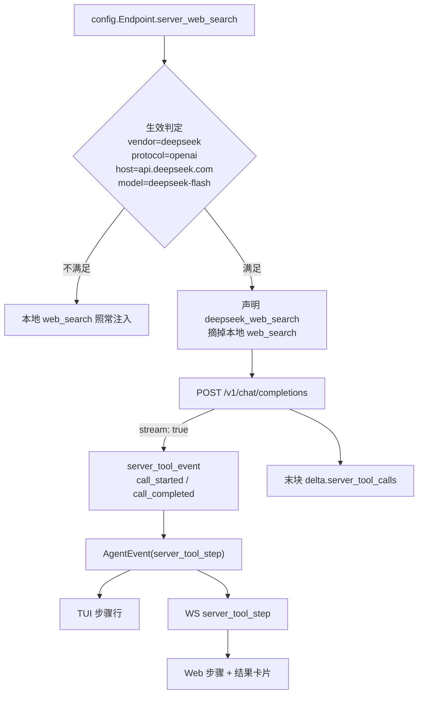
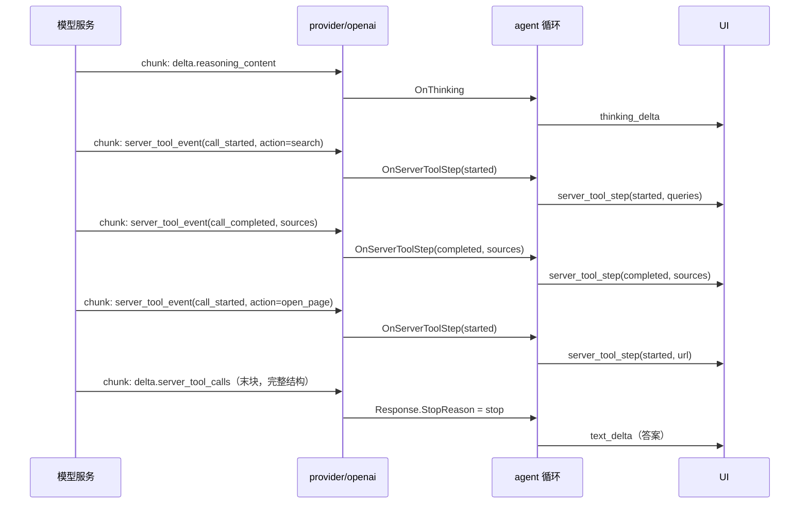

# DeepSeek 服务端搜索接入设计

## 背景与目标

octo 的 `web_search` 是**客户端工具**：模型产出工具调用，octo 自己发请求（DeepSeek Search API / Brave / Tavily / Serper，或抓取 DuckDuckGo、Bing 的 HTML），把结果拼进对话再让模型继续推理。一轮搜索至少两次模型往返。

DeepSeek 另有一套**服务端工具**：客户端在请求里声明 `deepseek_web_search`，检索和执行都在 DeepSeek 侧完成，模型直接带着搜索结果继续生成。收益是省掉一次往返、搜索本身不额外计费（只算 token），代价是能力由模型自主决定、且不经过 octo 的权限门。

目标：让配置了 DeepSeek 官方 endpoint 的用户可以打开这项能力，并在 octo 的两个 UI（TUI、Web）里实时看到搜索过程。

## 术语

| 词 | 含义 |
|---|---|
| 服务端工具 | 由模型服务端执行、客户端不派发的工具（本设计只接 `deepseek_web_search`） |
| 深度思考搜索（deep search） | thinking 开启时 `deepseek_web_search` 的行为：多步推理中反复搜索、开页、页内找词，最多约 20 次调用 |
| 步骤 | 一次服务端工具调用及其结果，`action` 为 `search`、`open_page` 或 `find_in_page` |
| 客户端搜索 | octo 现有的 `web_search` 工具（`internal/tools/web_search.go`） |

## 范围

**做**：

- `config.Endpoint` 新增 `server_web_search` 字段，默认关
- 满足条件的请求里声明 `deepseek_web_search`
- 流式解析 `server_tool_event`、非流式解析 `message.server_tool_calls`
- 新增 AgentEvent 与两端 UI：步骤行 + 结果卡片
- 开启时把本地 `web_search` 从线上请求的工具表里摘掉
- 审计日志、`octo doctor` 提示、endpoint 编辑界面上的开关

**不做**：

- `deepseek_read_url`（读取用户消息里的链接）。它要求把 `signature` 原样回传给后续轮次，属于另一条链路；读 URL 由本地 `web_fetch` 承担
- 行内引用（`citations`）渲染
- Anthropic 协议的原生 `web_search_20250305`，以及 Responses API 形态
- 会话级临时开关
- 对 400 的自动重试或启动探测
- `/cost` 统计里的搜索次数

## 现状（本设计依赖的代码事实）

| 事实 | 位置 |
|---|---|
| DeepSeek 供应商走 openai chat-completions，方言由供应商 id 决定 | `internal/app/sender.go:249`（`client.Dialect = name`）、`internal/app/provider.go:164-173` |
| DeepSeek 默认模型是 `deepseek-flash` | `internal/app/provider.go:168`（`DefaultModel: "deepseek-flash"`） |
| thinking 在该方言下默认开启，关闭必须显式发 `{"type":"disabled"}` | `internal/provider/openai/client.go:131-158` |
| 请求体的工具项是 `apiTool{Type, Function}`，只表达函数工具 | `internal/provider/openai/types.go:23-27` |
| 流式回调是 `provider.StreamCallbacks` 结构体，显式设计为新增事件只加字段 | `internal/provider/provider.go:92-113` |
| `ContentBlock` 只有 text / tool_use / tool_result / thinking / image 五种 | `internal/agent/content.go:10-23` |
| 工具表在每轮多处构造 | `internal/server/server.go:3934`、`internal/server/ws_handlers.go:1653`、`internal/server/tasks_handlers.go:412`、`internal/server/handlers.go:1318`、`internal/tools/registry.go:830` |
| octo 没有实现 `defer_loading`（服务端工具与它不兼容） | 全仓 grep 只命中 `dev-docs/tool-search-mcp.md` 的「不实现」说明 |

## 总体方案



## 详细设计

### 配置项

`config.Endpoint` 新增一个字段（`internal/config/config.go:113` 的结构体）：

```go
// ServerWebSearch declares DeepSeek's server-side deepseek_web_search tool on
// this endpoint's requests. Only effective for a DeepSeek endpoint on the
// official host with the deepseek-flash model — see ServerWebSearchEligible.
// Hand-editable and shown in the endpoint editor; hot-reloaded (the tool list
// and the sender are both rebuilt when config changes).
ServerWebSearch bool `yaml:"server_web_search,omitempty"`
```

生效判定集中在一个函数里，供三处复用（组装 sender、UI 展示、doctor 提示）：

```go
// ServerWebSearchEligible reports whether the endpoint/model pair can declare
// the server-side tool at all.
//
// Four conditions must all hold: the vendor is deepseek, the wire protocol is
// openai chat-completions, the base URL host is api.deepseek.com, and the model
// is deepseek-flash. A relay or self-hosted gateway is refused because those
// gateways routinely drop private extension fields, and a rejected request
// surfaces as a hard 400 mid-conversation; an unofficial vendor id is refused
// because only DeepSeek documents this tool.
func ServerWebSearchEligible(ep Endpoint, model string) bool
```

判定细节：`ep.Provider == "deepseek"`、解析后的协议为 `openai`（命名供应商的协议由注册表钉死，`internal/app/sender.go:204-217`）、`base_url` 为空或 `url.Parse(...).Hostname() == "api.deepseek.com"`、`model == "deepseek-flash"`。

不满足时该字段被忽略，且不报错——`octo doctor` 输出一行说明原因（见「监控与可观测」）。

### 请求注入

`openai.Client` 增加一个字段：

```go
// ServerWebSearch declares DeepSeek's deepseek_web_search server tool on every
// request this client makes. Set only when config.ServerWebSearchEligible
// said yes for the endpoint/model; the client does not re-check.
ServerWebSearch bool
```

`app.SenderOptions` 增加同名字段，`internal/app/sender.go:238-252` 的 openai 分支把它转到 client 上，`internal/app/sender.go:94` 的 `NewSender` 入口透传。三个构造点负责填值：`cmd/octo/chat.go:1555`、`internal/server/server.go:1661`、`internal/server/server.go:1869`。

线上形态（Chat Completions 扩展字段）：

```json
{
  "tools": [
    {"type": "function", "function": {"name": "read_file", "...": "..."}},
    {"type": "deepseek_web_search", "name": "deepseek_web_search"}
  ]
}
```

`apiTool` 需要能表达无 `function` 的项，改为：

```go
type apiTool struct {
	Type     string       `json:"type"`               // "function" | "deepseek_web_search"
	Name     string       `json:"name,omitempty"`     // server tools only
	Function *apiFunction `json:"function,omitempty"` // function tools only
}
```

`toAPITools` 产出函数工具时行为不变（`Function` 非 nil）；服务端工具项在 `ServerWebSearch` 为真时追加在函数工具之后。这个改动同时覆盖 `Send` 与 `SendStream` 两条路径，因为两者都经 `toAPITools`（`internal/provider/openai/stream.go:58`）。

`tool_choice` 不做改动：octo 目前不发送该字段，而 DeepSeek 明确禁止用它指定这两个服务端工具。

thinking 与档位的关系沿用现有方言逻辑，不额外开关：thinking 开启（默认）时 `deepseek_web_search` 表现为深度思考搜索，关闭时表现为普通搜索。两者都要解析。

### 摘掉本地 `web_search`

约束落在**组装线上请求时**，不在工具表构造处。理由：工具表按轮次在至少五处构造（见「现状」表的最后一行），逐个加判断必然漏一个；而"服务端搜索开启时不再暴露本地 `web_search`"是这条协议路径的约束，放到 `openai.toAPITools` 的调用点最贴近它的语义。

具体：`ServerWebSearch` 为真时，过滤掉 `Name == "web_search"` 的 `agent.ToolDefinition` 再序列化。要摘掉的只有搜索：`web_fetch` 保留，二进制识别、落盘、SSRF 守卫这些本地能力不可替代。

副作用：进程内的工具注册表仍含 `web_search`，它对模型不可见但仍在 `octo doctor` 的工具清单等问题面可见。这是可接受的现状差异，不做额外同步。

### 流式解析

DeepSeek 在流里用扩展字段 `server_tool_event` 描述进度（官方文档 “Chat Completions API → Streaming”）：

| `type` | 字段 | 处理 |
|---|---|---|
| `step_reasoning_done` | `step` | 忽略（思考内容本身走 `delta.reasoning_content`） |
| `call_started` | `step`、`call`（含完整 `action`） | 立即发出 `started` 步骤事件 |
| `call_completed` | `step`、`call`（含 `status`、`sources` / `page` / `error`） | 发出 `completed` / `failed` 步骤事件 |

末块 `delta.server_tool_calls` 携带完整结构，用于补全流里可能缺失的结果（`call_completed` 不含 `signature`，而本设计不接 `read_url`，因此不需要该字段）。



非流式路径（`Send`）从 `message.server_tool_calls` 一次性取全部步骤，只发出 `completed` 事件——一次性返回的结果没有"进行中"这个中间态。

### 数据形状

provider 侧（`internal/provider/provider.go`，与 `StreamCallbacks` 同文件）：

```go
// ServerToolStep is one server-side tool call reported by the provider. Search
// results ride Sources; page actions ride Page. DeepSeek nests these under
// message.server_tool_calls (non-streaming) and server_tool_event (streaming).
type ServerToolStep struct {
	ID       string   `json:"id"`
	Kind     string   `json:"kind"`             // search | deep_search | image_search | deep_image_search
	Action   string   `json:"action"`           // search | open_page | find_in_page
	Queries  []string `json:"queries,omitempty"`
	URL      string   `json:"url,omitempty"`    // open_page / find_in_page
	Pattern  string   `json:"pattern,omitempty"` // find_in_page
	Status   string   `json:"status"`           // started | completed | failed
	Error    string   `json:"error,omitempty"`  // failed 时的 error_code
	Sources  []ServerToolSource `json:"sources,omitempty"`
	Page     *ServerToolPage    `json:"page,omitempty"`
}

type ServerToolSource struct {
	Title     string `json:"title"`
	URL       string `json:"url"`
	Snippet   string `json:"snippet,omitempty"`
	SiteName  string `json:"site_name,omitempty"`
	Published string `json:"published_at,omitempty"` // 原文 page_age / published_at，原样透传
}

type ServerToolPage struct {
	URL       string `json:"url"`
	Title     string `json:"title,omitempty"`
	Published string `json:"published_at,omitempty"`
}
```

`StreamCallbacks` 增加字段（该结构体的注释明确把新增事件类归到这里，不需要改接口）：

```go
// OnServerTool fires for each server-side tool step as the service reports it.
// Nil-safe.
OnServerTool func(step ServerToolStep)
```

agent 侧新增事件种类（`internal/agent/event.go`，`EventThinkingDelta` 之后）：

```go
// EventServerTool fires per server-side tool step. The tool executes inside the
// model service, so this is observability only: no ToolExecutor is involved and
// nothing is dispatched.
EventServerTool EventKind = "server_tool"
```

`AgentEvent` 增加 `ServerTool *provider.ServerToolStep` 同形字段（agent 包不引入 provider，因此结构定义在 agent 包，provider 侧在 app 适配层转换——与现有 `Reply`/`Response` 双份定义的做法一致，见 `internal/agent/agent.go:125-131`）。

### 事件透传路径

`ToolStreamingSender.StreamMessagesWithTools` 的签名不动。agent 在 `RunStream` 里用 context 把 sink 传给 sender：

```go
// WithServerToolSink attaches the per-turn sink the sender adapter forwards to
// the provider. Mirrors withUpstreamSession: the agent stamps request-scoped
// data the adapter needs, and the adapter reads it instead of taking another
// parameter on a widely-implemented interface.
func WithServerToolSink(ctx context.Context, fn func(ServerToolStep)) context.Context
func ServerToolSink(ctx context.Context) func(ServerToolStep)
```

`internal/agent/agent.go` 的 `RunStream` 在构造 `onChunk` / `onThinking` 的同一处构造 sink 并把 ctx 传下去；`internal/app/sender.go` 的两处 `SendStream` 调用（`:366`、`:438`）从 ctx 取出 sink 填进 `provider.StreamCallbacks.OnServerTool`。

选这条路径的原因：`agent.Sender` 系列接口在本仓有 25 个 `StreamMessages` 实现与 12 个 `StreamMessagesWithTools` 实现（生产 1 个，其余为测试替身），加参数是 37 处机械改动且每次新增事件类都重演一遍；ctx 传值只改 3 个生产文件，且已有 `withUpstreamSession` 这个先例。

### UI

**Web**（`web/src/views/ChatView.svelte` 的 WS 订阅处 + `web/src/mobile/chatWiring.ts`）：

- 服务端把 `EventServerTool` 映射成 WS 消息 `{"type":"server_tool_step","session_id":…,"step":{…}}`（参照 `thinking_delta` 的映射，`internal/server/ws_handlers.go:2372-2381`）
- 前端按 `step.id` 聚合成一块卡片，每次事件就地更新：`started` 时插入一行（搜索显示查询词，`open_page` / `find_in_page` 显示 URL 与 pattern），`completed` 时补上结果数并渲染结果列表
- 结果列表复用 `ToolGroup.svelte` 里 `web_search` 卡的样式（`web/src/components/chat/ToolGroup.svelte:697-717`）
- 直播态需要能重放：`liveState` 的 replay buffer 里同时累积步骤事件，做法与 `thinkingBuf` 一致（`internal/server/ws_handlers.go:87-99`）

**TUI**（`cmd/octo/`）：每个步骤打一行状态行，完成时附结果数；不做结果卡片。

**为什么必须逐步行**：深度思考搜索在一次请求里可能产生 20 次调用，用户在此之前只有一条"思考中"的静止界面。步骤行是这段时间里唯一的进度信号。

### 审计日志

服务端工具绕过权限门（不经过 `ToolExecutor`、不产生工具调用记录），因此每次调用落一条结构化日志：

```go
slog.Info("server tool step",
	"tool", "deepseek_web_search",
	"model", req.Model,
	"action", step.Action,
	"kind", step.Kind,
	"queries", step.Queries,
	"url", step.URL,
	"results", len(step.Sources),
	"status", step.Status)
```

发在 `internal/provider/openai` 收到 `call_completed` 的位置，耗时另起字段。日志只记查询词、URL 与结果数，不记页面正文。

## 外部依赖契约

DeepSeek Chat Completions 的请求/响应扩展字段。以下字段名逐字取自官方文档 <https://api-docs.deepseek.com/guides/web_tools/>，实现时不得改写。

### 请求 `tools[]` 项

| 字段 | 类型 | 值 |
|---|---|---|
| `type` | string | `deepseek_web_search` |
| `name` | string | `deepseek_web_search` |

### 流式 `choices[].server_tool_event`

| 字段 | 类型 | 说明 |
|---|---|---|
| `type` | string | `step_reasoning_done` / `call_started` / `call_completed` |
| `step` | int | 该步骤序号 |
| `call.index` | int | 步骤内的调用序号 |
| `call.id` | string | `srvtoolu_…` |
| `call.type` | string | `deepseek_web_search` |
| `call.kind` | string | `search` / `deep_search` / `image_search` / `deep_image_search` |
| `call.action.type` | string | `search` / `open_page` / `find_in_page` |
| `call.action.queries` | []string | 仅 `search` |
| `call.action.url` | string | `open_page` / `find_in_page` |
| `call.action.pattern` | string | 仅 `find_in_page` |
| `call.status` | string | `completed` / `failed` |
| `call.sources[]` | array | `type`、`url`、`title`、`snippet`、`site_name`、`site_icon`、`published_at` |
| `call.page` | object | `url`、`title`、`published_at` |
| `call.error.code` | string | `url_not_accessible` / `url_not_allowed` / `unavailable` |

### 末块 `choices[].delta.server_tool_calls`

`[]`，每项 `{index, reasoning_content, calls[]}`，`calls[]` 的字段与上表 `call` 相同（含 `sources` / `page` / `status`）。

### 非流式 `message.server_tool_calls`

与上同形。另有 `message.annotations[]`（`type: url_citation`，含 `url_citation.url/title/start_index/end_index`）——本设计不渲染引用，只在解析时忽略。

### 已知约束

| 约束 | 处理 |
|---|---|
| `tool_choice` 不能指定这两个服务端工具，`none` 会关闭它们 | octo 不发 `tool_choice`；若将来加，需排除服务端工具 |
| `defer_loading` 不能与它们同用 | octo 未实现 `defer_loading`，无需处理 |
| 搜索不计费，只算 token；`usage.server_tool_use` 报告次数 | 不解析该计数，`/cost` 不体现 |
| 服务端搜索用 `deepseek-flash` | 判定函数限定该模型 |

## 兼容性

| 面 | 影响 |
|---|---|
| 旧 `config.yml` | 新字段 `omitempty`，缺失即 false；无迁移、无版本号变更 |
| 已保存的会话 | 历史里没有服务端块（本设计不持久化它们），恢复后只是看不到当时的搜索过程；模型的答案文本照旧完整 |
| 历史回传 | DeepSeek 明确说明 `server_tool_calls` 被框架丢弃时请求仍然成功，只是早先读到的页面不再在上文里；本设计不接 `read_url`，因此没有页面需要靠 `signature` 复原 |
| 非 deepseek 供应商 | 字段被忽略；`ServerWebSearchEligible` 首条即拒绝 |
| 中转站 / 自建网关 deepseek 端点 | 域名判定拒绝，避免必炸的 400；`octo doctor` 说明原因 |
| `deepseek-v4-pro` 等其他模型 | 判定拒绝；官方文档把 web tools 限定在 `deepseek-flash` |
| 现有 `web_search` 行为 | 仅当服务端搜索生效时从线上请求中摘除；本地工具、`octo doctor` 的 key 提示、抓取降级链全部不变（回归覆盖见测试计划） |
| Anthropic / Responses 协议 | 不涉及；`Client.ServerWebSearch` 只在 openai chat-completions 客户端上存在 |
| 会话分支 / 编辑重发 | 重发只是重放历史消息，不重放搜索步骤；显示层不依赖步骤事件，缺失时正常渲染 |

## 安全

| 点 | 结论 |
|---|---|
| 绕过权限门 | 服务端工具在 DeepSeek 侧执行，`permission_mode`/allowlist 无法拦截。这是能力的固有属性，因此：默认关闭、per-endpoint 显式开启、每步落审计日志 |
| 数据外发 | 模型把查询词与 URL 发给 DeepSeek（与已接入的 Search/Fetch API 相同）。不接 `read_url` 意味着 octo 不会主动把用户消息里的链接送给第三方 |
| 密钥 | 沿用现有 `Authorization` 头路径，不进入日志与 URL |
| 日志内容 | 只记查询词、URL、结果数；不记页面正文，避免把第三方内容写进本地日志 |
| 提示注入 | 搜索结果由服务端注入模型上下文，octo 不接触其正文；这也意味着 octo 无法对搜索结果做内容过滤或来源校验，需在文档中如实告知 |
| 域名门控 | 只认 `api.deepseek.com`，避免把用户数据经未知网关转发 |

## 高可用与降级

| 场景 | 行为 |
|---|---|
| 端点返回 400（不认该扩展） | 原样抛出，不重试、不静默降级。配置错误应当在错误里看见 |
| 搜索步骤 `failed`（`unavailable` 等） | 作为 `failed` 步骤事件渲染，模型会据此给出不带引用的回答；octo 不做重试 |
| 深度思考搜索耗时 | 单次请求可能含约 20 次服务端调用，总时长远超普通请求。流空闲超时沿用客户端现有 `StreamIdleTimeout`（`internal/provider/openai/client.go:117`），不额外调整；步骤事件本身会让流保持活动 |
| 并发 | 与普通模型请求同池，不新增配额维度 |
| 结果体积 | 搜索结果只进 provider 的内存结构，序列化进事件时整体受 `EventToolOutputCap`（8 KiB，`internal/agent/event.go:121`）约束；超限截断只影响 UI 事件，不影响模型上下文 |

## 配置与界面

- `config.yml`：`endpoints[].server_web_search: true`
- 热加载：endpoint 配置变更后，下一轮重建 sender 与工具表，无需重启（沿用现有 endpoint 热加载行为）
- 界面：`web/src/components/settings/EndpointsSection.svelte` 为该 endpoint 增加一个开关，**只在 `ServerWebSearchEligible` 相关的展示条件下出现**（供应商 deepseek 且域名为官方）；`deepseek-v4-pro` 等模型不满足时，开关旁给出「仅 deepseek-flash 生效」的说明而不是隐藏
- 文案：`web/src/lib/i18n.ts` 增加两处键（英文与中文各一段），键名沿用 `endpoints.*` 前缀

## 监控与可观测

- 审计日志：见「审计日志」
- `octo doctor`（`cmd/octo/doctor.go`）：在 endpoint 段落后新增一行
  - 生效：`✓ <endpoint id> 声明服务端搜索（deepseek_web_search）`
  - 字段为真但判定不通过：`! <endpoint id> 的 server_web_search 未生效：<原因>`，原因取自判定函数（非官方域名 / 非 deepseek / 非 openai 协议 / 模型不是 deepseek-flash）
- 不做指标上报（本仓没有 metrics 设施，不为此新建）

## 测试计划

`internal/provider/openai`：

- 请求序列化：`ServerWebSearch` 为真时 `tools[]` 含 `{"type":"deepseek_web_search","name":"deepseek_web_search"}`，且不含 `web_search` 函数工具；为假时两者都不出现
- 流式解析：`call_started` / `call_completed` 分别触发 `OnServerTool`，`sources` 字段完整映射；`find_in_page` 带出 `pattern`；`failed` 带出 `error.code`；末块 `server_tool_calls` 不重复发事件
- 非流式解析：`server_tool_calls` 一次性产出全部步骤事件
- 回归：普通函数工具请求体不变（`apiTool.Function` 为指针后，`function` 仍序列化为对象）

`internal/app`：

- `SenderOptions.ServerWebSearch` 转到 client 字段
- `StreamCallbacks.OnServerTool` 由 ctx sink 填充

`internal/agent`：

- ctx sink 在 `RunStream` 内被 stamp，`EventServerTool` 透传到 `EventHandler`
- sink 为 nil 时不 panic

`internal/config`：

- `ServerWebSearchEligible` 的四条件矩阵（各一条反例 + 全满足正例）

`cmd/octo`：

- doctor 的两条输出

前端：`EndpointsSection.svelte` 的显隐条件；`ChatView.svelte` 对 `server_tool_step` 的聚合（started → 行出现，completed → 结果数更新）

## 回滚

- 代码回滚：删掉注入与解析即可，配置字段保留无害（未知字段被忽略）
- 配置回滚：把 `server_web_search` 置回 false，下一轮生效，无需重启
- 数据回滚：无（不写数据库、不改会话格式）

## 发布顺序

单仓单 PR 内按编译依赖顺序落地：config 判定 → provider 请求注入与解析 → agent 事件透传 → server WS 映射 → 前端渲染 → doctor 与文档。无需多仓库协同。
